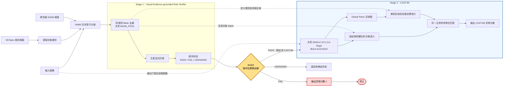

# Rule-LOCO（RuleAD）

RuleAD 是一个面向工业视觉异常检测的研究实现。当前活动模型是一个由 BAER 控制的**筛选式两级级联结构**：

- **Stage 1：Visual Evidence-grounded Rule Verifier（视觉证据驱动的规则验证器）**。执行数量、长度、面积、空间关系和属性组合约束；任一有效规则 `FAIL` 时，直接输出异常分数 `1` 并终止；
- **BAER：级间证据路由器**。读取规则汇总状态，决定终止、返回未确定状态或送入后级；
- **Stage 2：CASTJM**（Category-Aligned Semantic–Texture Joint Memory，类别对齐的语义—纹理联合记忆）。只有全部规则 `PASS` 的样本才进入后级，在同一正常参考下联合匹配固定类别槽位的对象语义与区域纹理偏差，输出一个异常分数。

**默认完整框架是规则驱动的 CASTJM 级联。** Global Patch 为 CASTJM 提供中间纹理异常图，也可独立用于纯纹理检测、定位或消融。独立 Global Patch 检测不是默认完整模型。

系统不更新 SAM3、CLIP 或 DINOv2 的参数。正常图像用于分割阈值和尺寸范围标定，以及非参数记忆构建。每条已执行规则保留实际值、期望值、满足分数、违反分数和错误信息，便于复核异常来源。

本仓库发布 RuleAD 的核心模型源码、建库与评测入口，以及模型运行所需的规则模板、属性词表和阈值配置。数据集和模型权重需要单独准备；缓存、记忆库、评测结果和实验日志均在本地生成，不随源码上传。

发布内容不包含 `assets/`、`cache/`、`datasets/`、`memory_banks/`、`results/`、`result/`、`seed/`、`logs/`、权重、论文草稿、提示词记录、实验选图清单、本机环境快照或维护脚本。`.gitignore` 按源码发布范围设置白名单；`templates/store/*.rules` 和 `config/` 中列出的运行配置是模型输入定义，不是图像、缓存或记忆库。

## 1. 方法概览



这张图描述默认完整模型的在线语义：**规则 FAIL 是终止节点；BAER 负责级间路由；CASTJM 只接收全部规则 PASS 的样本**。无 FAIL 但存在规则执行错误时，返回 `UNKNOWN` 并跳过后级。并行调度用于对照实验，取二值规则分数与 CASTJM 分数的最大值。

### 1.1 ViCSpec 规则模板

每个类别包含一份标准模板和一份通用模板：

- `*.standard.rules`：保存正常产品应满足的标准值；
- `*.generic.rules`：保留任务和对象定义，移除待观测的标准值。

当前支持五类任务：

| 任务 | 用途 | 主要证据 |
|---|---|---|
| `COUNT` | 对象数量约束 | 阈值筛选和去重后的 Mask 数量 |
| `LENGTH` | 长度范围内的实例数量约束 | Mask 主轴投影长度（像素） |
| `AREA` | 面积范围内的实例数量约束 | Mask 前景像素数 |
| `SPATIAL_COMBINATION` | 方向、包含、内部位置、自身对称 | Mask 几何关系 |
| `ATTRIBUTE_COMBINATION` | 多对象属性组合 | 观测属性元组与允许组合的匹配 |

模板示例：

```text
[C001] TASK=COUNT | SUBJECT=screw | PROPERTY=count | OP=EQ | VALUE=[2]
[C002] TASK=LENGTH | SUBJECT=screw | PROPERTY=length | OP=RANGE | VALUE=[282.1,318.74] | COUNT=[1]
[C003] TASK=SPATIAL_COMBINATION | SUBJECT=label | PROPERTY=spatial.position | OBJECT=bottle | OP=EQ | VALUE=at_middle | COUNT=[1]
```

仓库已提供 `breakfast_box`、`juice_bottle`、`pushpins`、`screw_bag` 和 `splicing_connectors` 的模板对。

### 1.2 SAM3 与共享 Mask 池

系统从通用模板收集并去重类别，对每个类别发送一次 SAM3 文本提示。原始候选先应用全局或类别级置信度阈值，再在**同一类别内部**按置信度排序并抑制重复 Mask：

- IoU 默认阈值：`0.80`；
- 小 Mask 被包含率默认阈值：`0.85`；
- 不同类别之间不做去重。

当前实现不包含最大连通域清理、最小面积过滤或 Mask 类别复核。CLIP 只处理复杂语义属性，不参与 SAM3 Mask 的类别验证或过滤。

### 1.3 Visual Evidence-grounded Rule Verifier：五类规则证据

每条有效规则采用二值判定，产生一对互补分数：

```text
satisfaction_score = s_i ∈ {0, 1}
violation_score    = v_i = 1 - s_i
```

- `PASS`：规则满足，且证据有效；
- `FAIL`：规则违反，且证据有效；
- `UNKNOWN`：规则执行错误，证据无效，分数为 `null`。

规则按模板顺序执行，在首个有效 `FAIL` 处停止。推理同时生成 `filled_template`，回填已执行规则的实际观测；提前退出时只包含已执行部分。

### 1.4 CASTJM：默认后级联合记忆

CASTJM 复用共享 Mask 池，并在规则全部通过后进行一次 DINOv2 特征提取：

1. **类别语义**：逐实例、逐层进行 Mask 平均池化与归一化，跨层汇总，再按 Mask 面积加权同类实例，形成固定类别顺序的语义描述。类别槽位不表示空间顺序或显式成对关系。
2. **区域纹理**：从 Global Patch 异常图提取各类别 Mask 并集及背景的均值、最高 `10%` 响应均值和最大值。不同类别区域允许重叠，背景为全部类别区域并集的补集。
3. **联合匹配**：两类描述使用正常参考统计逐维标准化，对每张正常参考计算加权联合距离，然后选择一个共同的最近参考。默认纹理权重为 `0.30`。
4. **正常标定**：正常纹理描述排除当前图像贡献的 Patch；联合记忆使用排除自身的最近邻距离最大值作为正常边界。

CASTJM 只输出一个图像级联合异常分数。Global Patch 的图像级分数不与该分数相加。

实现位于 `src/pro_innovation/memory_modules/castjm/`；完整级联入口为 `scripts/castjm/evaluate_rule_castjm_mvtec_loco.py`，建库入口为 `scripts/castjm/build_memory.py`。

### 1.5 Global Patch 与纯纹理定位

Global Patch 使用本地 DINOv2 ViT-L/14-Reg4，为 CASTJM 提供中间纹理异常图：

- 输入尺寸：`448 × 448`；
- 特征层：Block `6 / 12 / 18 / 24`；
- token 网格：`32 × 32`；
- 插值后的特征网格：`64 × 64`；
- 默认全图 Coreset 比例：`5%`。

每层查询 Patch 与正常 Coreset 做余弦最近邻匹配，四层异常图等权平均。Coreset 按正常图像分别进行确定性随机抽样。

独立 Global Patch 检测以异常图的空间最大值作为原始图像分数，并使用正常参考标定。GPPL 纯纹理定位头将该异常图恢复到评测分辨率，不调用类别语义、SAM3 或联合记忆；实现位于 `src/pro_innovation/memory_modules/castjm/pixel_texture.py`，评测入口为 `scripts/castjm/evaluate_pixel_texture.py`。

独立 Global Patch 模块与 CASTJM 分别位于 `memory_modules/global_patch` 和 `memory_modules/castjm`，模块之间不相互导入；CASTJM 拥有独立的 Global Patch 银行读取与评分实现，并复用 DINOv2 适配器。

### 1.6 筛选式级联与 BAER 路由

模型的标准推理语义如下：

1. Visual Evidence-grounded Rule Verifier 按模板顺序执行规则，首个有效 `FAIL` 即停止；
2. BAER 读取规则状态并执行级间路由；
3. 存在有效 `FAIL`：立即输出异常分数 `1` 并终止；
4. 无 `FAIL` 但存在 `UNKNOWN`：返回未确定状态，不运行后级；
5. 全部 `PASS`：BAER 将样本路由至 CASTJM，输出联合记忆异常证据。

CASTJM 使用联合最近邻原始距离 `d_joint` 和正常留一距离最大值 `T_joint` 评分：

```text
r_joint = d_joint / T_joint
image_anomaly_score = r_joint / (r_joint + 1)
```

完整 CASTJM 入口固定使用 `tau=1.0`，`r_joint > 1` 时判定异常。连续分数用于排序和 AUROC，不表示经过标签校准的真实概率。

四张正常图像用于分割阈值标定，不代表完整系统为 4-shot；正常记忆和部分尺寸范围使用的样本量需要分别记录。

## 2. 仓库结构

```text
rule-loco/
├── src/pro_innovation/
│   ├── adapters/              # SAM3、CLIP、DINOv2 本地适配器
│   ├── memory_modules/         # Global Patch、CASTJM 独立模块
│   ├── cli.py                 # 命令行入口与运行配置
│   ├── templates.py           # 规则解析、序列化和模板对齐
│   ├── pipeline.py            # 二值规则、BAER 路由与后级记忆接口
│   ├── mask_processing.py     # 同类别 Mask 去重
│   ├── geometry.py            # 长度、面积和等级分组
│   ├── spatial.py             # 空间关系与对称性
│   ├── attributes.py          # 颜色、形状和语义属性路由
│   ├── sam3_calibration.py    # 类别级 SAM3 阈值标定
│   └── evaluation.py          # 数据集评测、续跑和 AUROC
├── templates/store/           # 五个 MVTec LOCO 类别的模板对
├── scripts/
│   ├── fill_measurement_templates.py  # 正常图像标定 LENGTH/AREA 范围
│   └── castjm/
│       ├── build_memory.py            # CASTJM 联合记忆建库
│       ├── evaluate_rule_castjm_mvtec_loco.py  # 默认完整级联
│       ├── evaluate_mvtec_loco.py     # 独立 CASTJM 评测
│       └── evaluate_pixel_texture.py  # 纯纹理定位评测
├── config/
│   ├── *.json                # 属性候选词表
│   ├── sam3_thresholds/      # 五个类别的分割阈值策略
│   └── environment/requirements-inference.txt  # 推理依赖
├── examples/                 # 最小规则语法示例
└── pyproject.toml            # Python 包与 CLI 安装入口
```

## 3. 环境与外部资源

### 3.1 基础依赖

- Python `>= 3.10`
- NumPy `>= 1.24`
- Pillow `>= 10`
- PyTorch `>= 2.0`

实际运行还需要用户自行准备：

- 本地 SAM3 源码与 checkpoint；
- 本地 OpenAI CLIP 源码与 ViT-L/14 checkpoint（仅复杂语义属性需要）；
- DINOv2 ViT-L/14-Reg4 checkpoint（CASTJM 和独立 Global Patch 需要）；
- MVTec LOCO、MVTec AD 或 VisA 数据集。

模型适配器只读取本地路径，不会自动下载权重。源码中的默认路径对应原始开发环境；在其他机器上请显式传入模型、数据集和记忆库路径。CASTJM 脚本使用 `--dino-checkpoint`，通用 CLI 使用 `--patch-dinov2-checkpoint`。

### 3.2 安装

建议使用独立的 Python 3.12 环境。先安装与本机驱动匹配的 PyTorch / torchvision，再在仓库根目录安装推理依赖和当前项目：

```bash
python -m pip install -r config/environment/requirements-inference.txt
python -m pip install -e .
```

`requirements-inference.txt` 记录了本机已使用的直接依赖版本。SAM3、CLIP 和 DINOv2 源码需要另外准备，并满足各自的依赖要求。例如已有对应源码时：

```bash
python -m pip install --no-deps --no-build-isolation \
  -e /path/to/SAM3 -e /path/to/CLIP
export PYTHONPATH="/path/to/DINOv2:${PYTHONPATH}"
```

DINOv2 适配器从 `dinov2.hub.backbones` 导入模型定义；可通过上面的 `PYTHONPATH` 或环境内的 `.pth` 文件使该源码可导入。第三方源码、环境目录和模型权重不包含在本仓库中。

### 3.3 检查命令行

在仓库根目录执行：

```bash
PYTHONPATH=src python -m pro_innovation --help
PYTHONPATH=src python -m pro_innovation infer --help
PYTHONPATH=src python -m pro_innovation evaluate --help
PYTHONPATH=src python scripts/castjm/build_memory.py --help
PYTHONPATH=src python scripts/castjm/evaluate_rule_castjm_mvtec_loco.py --help
```

默认完整框架使用 CASTJM 脚本入口。通用 CLI 的 `infer` / `evaluate` 保留规则单独运行及独立 Global Patch 路径，以下示例按用途区分。

## 4. 快速开始

### 4.1 校验模板

```bash
PYTHONPATH=src python -m pro_innovation validate \
  templates/store/screw_bag.standard.rules

PYTHONPATH=src python -m pro_innovation validate --generic \
  templates/store/screw_bag.generic.rules
```

从标准模板生成通用模板：

```bash
PYTHONPATH=src python -m pro_innovation make-generic \
  templates/store/screw_bag.standard.rules \
  --output /tmp/screw_bag.generic.rules
```

### 4.2 规则推理

下面的命令只展示必要结构；请替换本机模型路径：

```bash
PYTHONPATH=src python -m pro_innovation infer \
  --class-name screw_bag \
  --image /path/to/test.png \
  --generic templates/store/screw_bag.generic.rules \
  --standard templates/store/screw_bag.standard.rules \
  --sam3-repo /path/to/SAM3 \
  --sam3-checkpoint /path/to/sam3.pt \
  --sam3-threshold-policy \
    config/sam3_thresholds/confidence_gap_midpoint_4-shot/screw_bag.json \
  --device cuda \
  --output report.json
```

含复杂语义属性的类别还需要属性词表和 CLIP 路径，例如：

```bash
--attribute-vocabulary config/juice_bottle.attribute_vocabulary.json \
--clip-repo /path/to/CLIP \
--clip-checkpoint /path/to/ViT-L-14.pt
```

### 4.3 默认完整 CASTJM 级联

完成 SAM3 阈值标定、Global Patch 基础库和 CASTJM 联合库构建后，使用以下入口逐图运行完整级联。Visual Evidence-grounded Rule Verifier 是第一阶段，BAER 负责级间路由，CASTJM 是第二阶段。

```bash
PYTHONPATH=src python scripts/castjm/evaluate_rule_castjm_mvtec_loco.py \
  --dataset mvtec_loco \
  --class-name screw_bag \
  --dataset-root /path/to/mvtec_loco_anomaly_detection/screw_bag/test \
  --generic templates/store/screw_bag.generic.rules \
  --standard templates/store/screw_bag.standard.rules \
  --threshold-policy /path/to/screw_bag.thresholds.json \
  --global-bank /path/to/global-patch-bank.npz \
  --joint-bank /path/to/screw_bag.castjm_tw030_top010.npz \
  --schedule binary-selective \
  --sam3-repo /path/to/SAM3 \
  --sam3-checkpoint /path/to/sam3.pt \
  --dino-checkpoint /path/to/dinov2_vitl14_reg4.pth \
  --result-root /path/to/results \
  --device cuda
```

该入口遍历所选类别的测试划分，并将逐图结果写入 `<result-root>/<class-name>/all.jsonl`。含语义或颜色属性的类别需提供相应的 `--attribute-vocabulary`；复杂语义属性还需 CLIP 路径。

## 5. 正常记忆与阈值构建

默认完整框架依次准备 5.1 的 SAM3 阈值、5.2 的 Global Patch 基础库和 5.3 的 CASTJM 联合库。两个记忆库需要使用同一组、同一顺序的正常参考图像。

### 5.1 标定类别级 SAM3 阈值

```bash
PYTHONPATH=src python -m pro_innovation calibrate-sam3-thresholds \
  --class-name screw_bag \
  --normal-dir /path/to/screw_bag/train/good \
  --standard templates/store/screw_bag.standard.rules \
  --sam3-repo /path/to/SAM3 \
  --sam3-checkpoint /path/to/sam3.pt \
  --output /path/to/screw_bag.thresholds.json \
  --device cuda
```

标定候选阈值默认从 `0.20` 生成候选；`confidence_gap_midpoint` 根据必须保留与多余实例的置信度间隔选择类别阈值。该过程不更新 SAM3 参数。

`config/sam3_thresholds/confidence_gap_midpoint_4-shot/` 同时提供原实验五个类别的阈值策略。文件中的 `calibration_images` 仅记录原标定图像路径，不包含图像；切换数据集、权重或对象定义后应重新标定。以下建库和完整评测使用的阈值策略必须一致。

当前 `breakfast_box` 策略未为 `banana slices`、`box` 和 `almonds` 单独设置阈值；CASTJM 建库与完整评测入口会提示缺失项，并使用 `--sam3-threshold`（默认 `0.40`）回退。复现实验时，建库和评测应传入相同的回退值；也可重新标定以补全类别阈值。

### 5.2 构建 Global Patch 基础库

```bash
PYTHONPATH=src python -m pro_innovation build-patch-memory \
  --class-name screw_bag \
  --normal-dir /path/to/screw_bag/train/good \
  --patch-dinov2-checkpoint /path/to/dinov2_vitl14_reg4.pth \
  --patch-coreset-ratio 0.05 \
  --output /path/to/global-patch-bank.npz \
  --device cuda
```

该基础库为 CASTJM 提供正常 Patch 参考和纹理异常图，也支持独立纯纹理评测。

### 5.3 构建 CASTJM 联合记忆

```bash
PYTHONPATH=src python scripts/castjm/build_memory.py \
  --class-name screw_bag \
  --normal-dir /path/to/screw_bag/train/good \
  --generic templates/store/screw_bag.generic.rules \
  --threshold-policy /path/to/screw_bag.thresholds.json \
  --global-bank /path/to/global-patch-bank.npz \
  --sam3-repo /path/to/SAM3 \
  --sam3-checkpoint /path/to/sam3.pt \
  --dino-checkpoint /path/to/dinov2_vitl14_reg4.pth \
  --texture-weight 0.30 \
  --top-fraction 0.10 \
  --output /path/to/screw_bag.castjm_tw030_top010.npz \
  --device cuda
```

联合建库要求至少两张正常参考图像。脚本读取 Global Patch 库记录的参考图像顺序，生成语义与纹理描述，并保存标准化统计量及联合距离边界。

## 6. 数据集评测

CASTJM 评测脚本和通用 CLI 的 `evaluate` 支持：

- `mvtec_loco`：固定的 `good`、`logical_anomalies`、`structural_anomalies`；
- `mvtec_ad`：自动发现 `good` 之外的缺陷目录；
- `visa`：读取官方 `split_csv/1cls.csv`。

默认完整 CASTJM 级联使用 4.3 的命令。CASTJM 脚本的 `--dataset-root` 对 MVTec LOCO / MVTec AD 指向类别的 `test` 目录，对 VisA 指向包含 `split_csv/1cls.csv` 的数据集根目录。

完整 CASTJM 评测需要同时提供有效的模板、阈值策略、Global Patch 基础库和联合库。该脚本在缺少有效阈值策略时会直接运行 Global Patch，关闭分割与联合记忆；缺少模板时会关闭规则执行。这些简化路径不代表默认完整框架。

独立 Global Patch 消融使用通用 CLI，不需要模板或 SAM3：

```bash
PYTHONPATH=src python -m pro_innovation evaluate \
  --dataset mvtec_ad \
  --dataset-base /path/to/mvtec_anomaly_detection \
  --class-name bottle \
  --no-rule-inference \
  --patch-matching \
  --patch-bank /path/to/bottle.patch-bank.npz \
  --patch-dinov2-checkpoint /path/to/dinov2_vitl14_reg4.pth \
  --device cuda
```

CASTJM 入口按已有 `all.jsonl` 中的图像路径续跑；配置或逻辑改变时应使用新的结果目录或 `--restart`，避免复用旧记录。通用 CLI 按参数匹配的 JSONL 续跑。

### 6.1 纯纹理 Pixel 评测

GPPL 读取已有 Global Patch 库，在 `448 × 448` 上对预测热力图和真值掩码进行一致评测。MVTec AD 使用 `ground_truth/<defect>/*_mask.png`，VisA 使用官方 `split_csv/1cls.csv` 的 `mask` 列。入口逐图缓存 `64 × 64` Patch 异常图，可中断后直接重跑续算；输出逐类及宏平均 Image AUROC 和 Pixel AUROC。

```bash
PYTHONPATH=src python scripts/castjm/evaluate_pixel_texture.py \
  --dataset mvtec_ad \
  --dataset-root /path/to/mvtec_anomaly_detection \
  --bank-root /path/to/mvtec-ad-global-banks \
  --dino-checkpoint /path/to/dinov2_vitl14_reg4.pth \
  --result-root /path/to/results/gppl_mvtec_ad \
  --shot full \
  --device cuda

PYTHONPATH=src python scripts/castjm/evaluate_pixel_texture.py \
  --dataset visa \
  --dataset-root /path/to/visa \
  --bank-root /path/to/visa-global-banks \
  --dino-checkpoint /path/to/dinov2_vitl14_reg4.pth \
  --result-root /path/to/results/gppl_visa \
  --shot full \
  --device cuda
```

`--bank-root` 指向已在本机建立的逐类别 Global Patch 库目录；`full` 模式要求文件名匹配 `<class-name>.dino_full_*.npz`，每个类别恰好一份。可用第 5.2 节的建库入口，将 `--output` 指定为该目录下符合此命名的文件。`--shot` 还支持 `1`、`2`、`4`，对应文件名为 `<class-name>.dino_<shot>shot_fullpatch.npz`；不传 `--bank-root` 时，脚本按 shot 自动选择默认目录。该入口不读取模板、自定义分割阈值文件、SAM3 或 CASTJM 联合记忆库。

## 7. 输出与运行模式

默认 CASTJM 入口通过 `--schedule` 选择调度；通用 CLI 的对应参数为 `--rule-memory-schedule`：

- `binary-selective`（默认）：规则使用 0/1 分数，首个有效 FAIL 即退出并输出 1；全部 PASS 才运行 CASTJM；无 FAIL 但存在 UNKNOWN 时返回未确定状态。
- `binary-parallel`：共享分割后并行运行规则与 CASTJM，最终取二者分数最大值；规则分支仍在首个 FAIL 时停止。

旧的连续规则评分模式 `selective`、`parallel` 已移除，传入这些名称会报配置错误。后置记忆检测的连续异常分数保留。

默认 CASTJM 入口在逐图 `all.jsonl` 中记录：

- `score`：最终图像级异常分数；
- `execution_mode`：实际执行路径；
- `rules`、`mask_counts`：已执行规则的证据及最终 Mask 数量；
- `castjm_evidence`：联合距离、正常边界、最近正常参考及类别语义和区域纹理距离；规则提前退出时为 `null`；
- `timings_seconds`、`error`：分阶段计时与执行错误。

共享流水线的单图报告使用以下字段名；通用 CLI 的 `infer` 直接输出该报告：

- `image_anomaly_score`：整图连续异常分数；
- `execution_mode`：实际执行路径；
- `categories`、`mask_counts`：模板类别及最终 Mask 数量；
- `results`：各规则的实际值、期望值、满足/违反分数和证据有效性；
- `filled_template`：观测值回填后的模板；
- `patch_evidence`：独立 Global Patch 的距离、标定与纹理比率证据；默认 CASTJM 路径为 `null`，因为 Global Patch 只提供内部纹理异常图；
- `composition_evidence`：CASTJM 后置记忆证据；这是保留的接口字段名，在默认评测输出中写为 `castjm_evidence`。

实现中可能出现以下标准或消融运行模式：

| 模式 | 含义 |
|---|---|
| `rule_binary_dual_post` | 默认 CASTJM 路径全部规则通过后执行联合记忆；模式名沿用内部接口，不表示两个图像分数相加 |
| `rule_binary_early_exit` | 规则 FAIL，提前退出并输出异常分数 1 |
| `rule_binary_memory_parallel` | 二值规则与 CASTJM 的并行对照，取分数最大值 |
| `rule_binary_only` | 仅运行二值规则筛选，或在无 FAIL 但存在 UNKNOWN 时返回未确定状态 |
| `rule_binary_patch` | 兼容路径：二值规则通过后运行独立 Global Patch |
| `patch_only` | 关闭规则筛选，仅运行 Global Patch 消融 |

`composition_only` 表示关闭规则后执行联合记忆；`dual_post` 是内部同时接入独立 Patch 与组合评分器的兼容模式，不属于默认 CASTJM 级联。

`infer` 的退出码：正常为 `0`，检测到异常为 `1`，配置或运行失败为 `2`。

## 8. SAM3 缓存

Mask 路径支持四种缓存模式：

- `off`：禁用缓存；
- `read`：只读，缺失即报错；
- `read-write`：读取命中并补写缺失项；
- `refresh`：重新计算并原子替换。

缓存键包含图像内容、checkpoint 身份、提示模板和类别。建议先用较低候选阈值建立完整缓存，再在规则推理中应用更严格的全局或类别阈值。

## 9. 当前边界

- 本项目是研究代码，不是经过产品化验证的质量判定系统；
- 模板需要人工确认，当前没有绑定在线多模态模型自动生成标准模板；
- 简单形状只区分 `square`、`round`、`elongated`；颜色为候选调色板中的平均 RGB 最近项；
- 空间关系是可解释的几何启发式，并非学习得到的空间概率模型；
- CLIP 只在用户提供的候选属性词表内分类，标准答案不会动态注入候选集；
- 连续分数是可比较的证据分数，不应直接解释为异常发生概率；
- SAM3 的候选置信度不能量化“完全漏检对象”的概率；
- 不同数据集、类别、DINO checkpoint 和 Coreset 比例对应不同记忆库，不能混用；
- 源码中的绝对默认路径不具备跨机器可移植性，公开使用时应显式覆盖。

## 10. 许可与引用

仓库当前未附带许可证；在许可证明确之前，请勿默认其允许商业使用或再分发。若用于论文或实验，请同时注明所使用的 SAM3、CLIP、DINOv2 及数据集版本，并记录模板、阈值策略、记忆库和评测参数。
